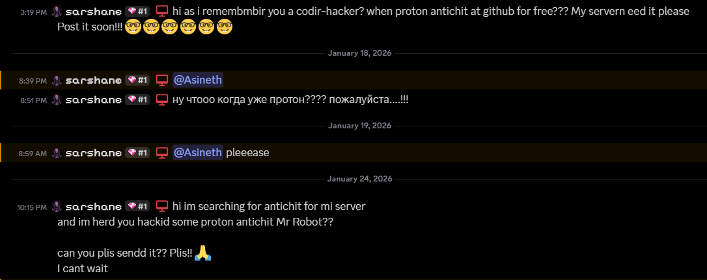
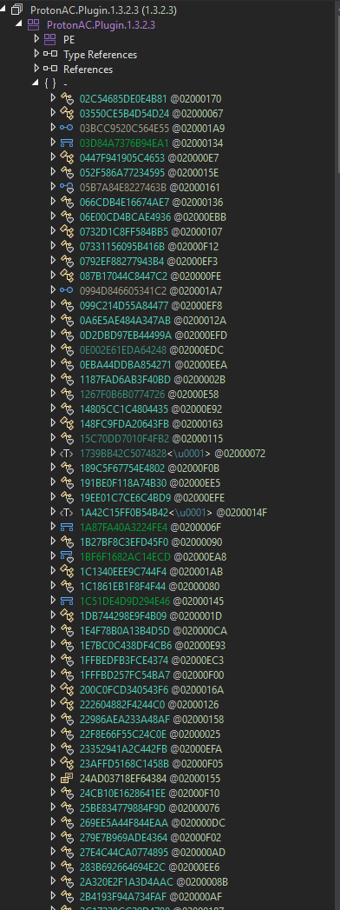
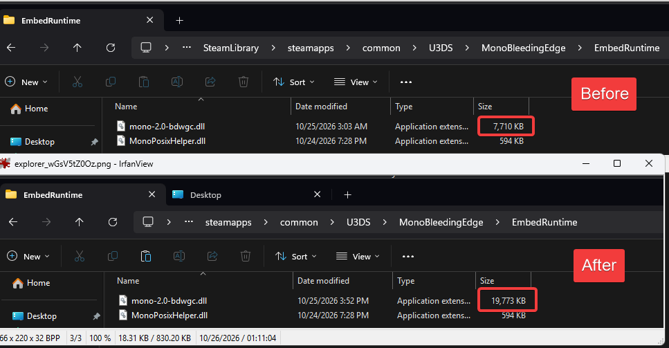
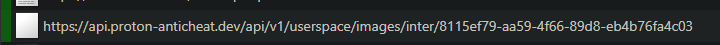

# ProtonAC 1.3.2.3 full dump

hi guys it's favorite chairman of the CCP, Xi Jinping here again with big release for Chinese Thanksgiving: ProtonAC 1.3.2.3 (latest version Oct 26 2026) full dump + crack. i would like to give big shoutout to our niggas at Hamas Client for provide us with key and loader, thank you for support.

ProtonAC is a vibe-coded AI slop anti-cheat coded by a couple retarded russians who can barely code or use a computer. most of the code you will see is stolen from [Darkness Anti-Cheat](https://github.com/Darkness-Anti-Cheat/Darkness-AntiCheat) which is a free and public anti-cheat on GitHub.

it is also used on the popular server "Unturned Roleplay" owned by a big youtuber who refuses to ban pedophiles on his server where he promotes gambling to kids.

## overview

you know me, i always bring big package with lots of gifts:

- `decompiled_src`: full decompiled C# source for ProtonAC.Plugin, all anti-cheat shit is in here
- `loader_src`: messy but somewhat deobfuscated C# loader source
- `dumps`: various dumps of the vmp-packed dlls he ships and replaces your server files with
- `loader`: untouched loader files in case you want to reverse etc
- `ProtonAC.Loader_rebuilt.dll`: rebuilt ProtonAC.Loader dll
- `ProtonAC.Plugin_rebuilt.dll`: rebuilt ProtonAC.Plugin dll (just drag into dnspy)

have fun and happy slopping

## protection + what he does to your server

when running ProtonAC for the first time, the loader will download and replace `mono-2.0-bdwgc.dll` on your server which is a file that ships with the Unturned server and replace it with a modified version. 

### ⚠️ **even after you remove ProtonAC from your modules folder, this stays until you full reinstall your server** ⚠️

the main reaosn for this is because the main ProtonAC plugin dll is using a custom metadata and IL encryption that the modified mono dll handles when it's loaded. this provides some protection but ultimately is some retarded idea likely came up with by Claude.

what is more concerning is that this dll stays even after you remove ProtonAC from your server and is heavily obfuscated using VMP which means that you have no idea what's really going on in the dll. 

## telemetry + spying

the plugin phones home to 2 russian VPSes:

- `api.proton-anticheat.dev` / `37.59.98.149`
- `pro.sarshane.store` / `45.146.167.182`

### in addition to the server phoning home to his server, **all of your players** phone home as well.  (whether they like it or not)

every time a player joins your server, proton injects a chat message with the avatar URL set to a link from `api.proton-anticheat.dev` to grab their IP. this means that proton's servers log the IPs of every single player that joins your server without you knowing. this could easily be done on the server but is done in a stealthy way, like to collect your players's data.

## credits

- nox, CEO of HamasClient: supplying loader + key
